<div align="center">


<br/>

<a href="#english">

</a>
<a href="#نسخه-فارسی">

</a>

<br/><br/>


<br/><br/>

<a href="https://github.com/sinajr2011-prog">

</a>
<a href="https://linkedin.com/in/sina-jafari-a031b9419">

</a>
<a href="mailto:sinajr2011@gmail.com">

</a>

</div>

<a id="english"></a>

---

## 🔥 Flagship Project: Nova-Edu

<div align="center">

### **نِوا | Nova-Edu**
#### The first specialized Iranian educational LLM + multi-agent tutor system

<a href="https://github.com/sinajr2011-prog/nova-edu">

</a>

</div>

**Nova is not another chatbot wrapper.**  
It is being built as a serious educational intelligence engine for Iranian students:

- 🧠 Specialized focus on textbooks + Konkur + Tizhooshan + Olympiad
- 🤖 Multi-agent system (Mistake Finder, Question Designer, Visual Explainer, Advisor)
- 🧩 Long-term student memory
- 🖼️ Educational image + video generation layer
- 🔌 REST API for integration into real learning platforms
- 🚀 Independent model path (SFT → DPO → local inference)

```text
Platform / App / LMS
        ↓
     Nova API
        ↓
Agents + Memory + LLM + Multimodal
```

<a href="https://github.com/sinajr2011-prog/nova-edu">

</a>

---

## 👋 About Me

I'm **Sina Jafari** — a student developer building ambitious AI + EdTech systems.

I care about products that actually help learners, not just demos.

```text
┌──────────────────────────────────────────────────────┐
│  🔥 Flagship      → Nova-Edu                         │
│  🤖 Focus         → Educational AI & Agents          │
│  🏫 Also Building → Quanta / Kharazmika ecosystem    │
│  🧰 Stack         → Python, PHP, Full-Stack, AI      │
│  🌍 Goal          → Build tools that matter          │
└──────────────────────────────────────────────────────┘
```

> **Build it. Learn from it. Improve it. Ship it. 🚀**

---

## 🚀 Featured Projects

<table>
<tr>

<td width="50%" valign="top">

<h3>🔥 Nova-Edu</h3>

Specialized Iranian educational AI system with agents, memory, multimodal generation, platform API, and an independent training path.

**AI • Education • Agents • Python**

<a href="https://github.com/sinajr2011-prog/nova-edu">

</a>

</td>

<td width="50%" valign="top">

<h3>🏫 Quanta</h3>

An AI-focused intelligent school platform built around the idea of a school for the future.

**Education • AI • Full-Stack**

<a href="https://github.com/sinajr2011-prog/Quanta">

</a>

</td>

</tr>

<tr>

<td width="50%" valign="top">

<h3>⚔️ Kharazmika Arena</h3>

Nationwide math competition platform with XP, duels, leagues, class codes and seasonal systems.

**EdTech • Gamification • JS**

<a href="https://github.com/sinajr2011-prog/kharazmika-arena">

</a>

</td>

<td width="50%" valign="top">

<h3>🤖 Persian AI Toolkit</h3>

Practical AI utilities and experiments for the Persian developer ecosystem.

**Python • AI • Developer Tools**

<a href="https://github.com/sinajr2011-prog/persian-ai-toolkit">

</a>

</td>

</tr>
</table>

---

## 🧰 Tech Stack

<div align="center">


<br/><br/>


</div>

<br/>

<div align="center">

**AI & Systems**  
🤖 LLMs • 🧠 Agents • 🧪 Fine-Tuning • 🔌 REST APIs • 🧩 Platform Integrations

**Workflow**  
🐙 Git • ⚙️ GitHub Actions • 🐳 Docker • 🐧 Linux

</div>

---

## 📊 GitHub Dashboard

<div align="center">


<br/>


</div>

---

## 📈 Contribution Activity

<div align="center">


</div>

---

## 🏆 GitHub Trophies

<div align="center">


</div>

---

## 🐍 Contribution Snake

<div align="center">


</div>

---

## 🎮 Contribution Arcade

<div align="center">



</div>

---

## 💻 Developer Terminal

<div align="center">

```text
╭────────────────────────────────────────────────╮
│   sina@github ~ $ whoami                       │
│   > Sina Jafari                                │
│                                                │
│   sina@github ~ $ focus                        │
│   > Educational AI • Agents • Full-Stack       │
│                                                │
│   sina@github ~ $ building                     │
│   > Nova-Edu 🔥                                │
│                                                │
│   sina@github ~ $ status                       │
│   > ████████████████████ ONLINE                │
╰────────────────────────────────────────────────╯
```

</div>

---

## 🔭 Currently Building

| 🚀 Project | 🎯 Focus |
|---|---|
| 🔥 **Nova-Edu** | Specialized Iranian educational LLM + agents |
| 🏫 **Quanta** | Intelligent school platform |
| ⚔️ **Kharazmika Arena** | Gamified math competition system |
| 🤖 **AI Tools** | Practical AI experiments |
| 🧰 **Open Source** | Building in public |

---

## 🌱 Currently Learning

```text
Educational LLMs & Agents   ██████████████████░░
Fine-Tuning / QLoRA         ███████████████░░░░░
Full-Stack Architecture     █████████████████░░░
Platform Integrations       ██████████████░░░░░░
Open Source Systems         ████████████████░░░░
```

---

## 🎯 My Developer Philosophy

<div align="center">

> ### **Ideas are cheap. Building is the fun part.**

**Think → Build → Break → Learn → Improve → Ship**

</div>

---

## 🇮🇷 نسخه فارسی

<details>
<summary><strong>🇮🇷 برای مشاهده نسخه فارسی کلیک کنید</strong></summary>

<br/>

### سلام! من سینا جعفری هستم 👋

من یک دانش‌آموز و برنامه‌نویس هستم و روی سیستم‌های جدی **هوش مصنوعی آموزشی** کار می‌کنم.

### 🔥 پروژه پرچم‌دار من: Nova-Edu

**نِوا** اولین مسیر جدی برای ساخت یک مدل زبانی تخصصی آموزش ایران است:

- تمرکز روی کتاب درسی + کنکور + تیزهوشان + المپیاد
- سیستم چندعاملی (تشخیص اشتباه، طراح سوال، مشاور، توضیح تصویری)
- حافظه بلندمدت دانش‌آموز
- API برای اتصال به پلتفرم‌های آموزشی
- مسیر مستقل‌شدن مدل (فاین‌تیون + اجرای محلی)

🔗 مخزن پروژه: [nova-edu](https://github.com/sinajr2011-prog/nova-edu)

### بقیه تمرکزها
- 🏫 **Quanta** — سامانه هوشمند مدرسه
- ⚔️ **Kharazmika Arena** — رقابت و گیمیفیکیشن ریاضی
- 🤖 ابزارهای AI و پروژه‌های فول‌استک

> **بساز. یاد بگیر. بهترش کن. منتشرش کن. 🚀**

</details>

---

<div align="center">

### 🤝 Let's Build Something Awesome

**Open to collaborations in Educational AI, agents, and real product building.**

<br/>

<a href="https://github.com/sinajr2011-prog/nova-edu">

</a>

<a href="https://github.com/sinajr2011-prog">

</a>

<a href="https://linkedin.com/in/sina-jafari-a031b9419">

</a>

<br/><br/>


**Made with ❤️ by Sina Jafari**

<a href="#top">
  
</a>

</div>
